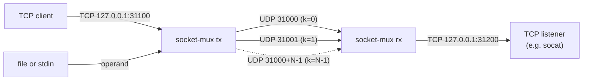

# socket-mux

socket-mux carries one stream over N UDP lanes so that the limits of a single network flow do not cap its throughput. One flow is sent by one thread, lands in one receive queue serviced by one core, passes through whatever a single-queue or poorly designed network driver allows, and queues in one socket buffer; N lanes, each with its own port, socket and thread, get past those limits without kernel or driver changes. On 10GbE, two lanes reach about 9.4 Gbit/s where one lane stays below line rate, at about 5.5 to 8.5 Gbit/s ([exercise 3](#3-what-lanes-buy-10gbe-linux-to-linux)). It is built to move data from an acquisition machine to a compute machine. TX reads one input (a TCP connection on localhost, standard input or a file) or generates a test pattern (`tx-pat`), and splinters it into N UDP lanes (N configurable, default 1). RX receives the lanes and reassembles the original stream. A header on every datagram lets RX put slices in order and measure loss. Nothing is retransmitted, so the channel is lossy. Loss is normal on such a channel, so a transfer's success is judged by its total error rate, the datagrams lost over the datagrams sent: on a 10 Gbit/s link through a single switch, three to five nines (99.9 % to 99.999 %) of the datagrams arrive. Linux x86_64 (static musl) is qualified on this build. Windows x86_64 qualification is next, pending a test peer; Linux aarch64 qualification is deferred. macOS was tested by the project owner on an earlier build; the current build has not yet been re-tested on macOS.

## Features

| Capability                                                                                                                                                                                                                                                                                 | Status                                                                                                                                                                                                |
| ------------------------------------------------------------------------------------------------------------------------------------------------------------------------------------------------------------------------------------------------------------------------------------------ | ----------------------------------------------------------------------------------------------------------------------------------------------------------------------------------------------------- |
| One input stream, from a localhost TCP connection, standard input or a file, split across N UDP lanes; lane k uses port base+k                                                                                                                                                             | implemented                                                                                                                                                                                           |
| A sequence number in every datagram header, for in-order reassembly and for detecting loss and its length                                                                                                                                                                                  | implemented                                                                                                                                                                                           |
| Late and duplicate datagrams are dropped                                                                                                                                                                                                                                                   | implemented                                                                                                                                                                                           |
| Lossy by design: no retransmission; each loss gap is skipped and counted with its cause (ipd or window; window loss also comes from a slow reader of RX's output and from gaps RX gives up early to free its buffers)                                                                      | partial: this build reports the causes timeout, memory and output                                                                                                                                     |
| One inter-packet delay at RX, default 1 ms, settles every missing datagram and the end of the stream; TX sends without pacing                                                                                                                                                              | not yet implemented: this build waits a 10 s timeout (`--timeout`) and can pace `tx-pat` (`--ipd-ns`), and its Verification suites test those                                                         |
| Bounded RX memory: every datagram RX receives, holds for ordering or has yet to write to its TCP output sits in one preallocated arena of a configurable RX memory limit and passes between threads by pointer, without copying; strict in-order delivery, no heap allocation per datagram | partial: this build shares one RX memory limit between held datagrams and the TCP output and releases gaps at a memory reserve                                                                        |
| Configurable lane count (default 1, minimum 1), base port, RX inter-packet delay and datagram size (default: the adapter MTU less 48 bytes)                                                                                                                                                | partial: this build has no `--ipd`                                                                                                                                                                    |
| Byte counts with SI and IEC suffixes, such as `--bytes 3G` and `--rx-memory 64Mi`                                                                                                                                                                                                          | not yet implemented: this build takes plain integers                                                                                                                                                  |
| One warning at start when the datagram size exceeds the adapter MTU less 48 bytes                                                                                                                                                                                                          | implemented                                                                                                                                                                                           |
| Loss warnings while the stream runs and one summary at the end, in the manner of iperf3, with the largest out-of-sequence delay and why RX ended                                                                                                                                           | partial: this build prints rate and loss lines every second (`--interval`) instead of loss warnings, logs its start-up lines at `info`, and prints neither the out-of-sequence delay nor why RX ended |
| SIGINT and SIGTERM (Ctrl-C and console close on Windows) end TX and RX with their summary and status 130 or 143                                                                                                                                                                            | implemented; the Windows console handling is not yet built or run on Windows                                                                                                                          |
| TX and RX back to back as a verification loop, with a generated pseudorandom pattern as TX's input                                                                                                                                                                                         | implemented                                                                                                                                                                                           |
| Linux x86_64 (static musl), required for the first release                                                                                                                                                                                                                                 | qualified on this build                                                                                                                                                                               |
| Linux aarch64 (static musl)                                                                                                                                                                                                                                                                | built; qualification deferred, not tested                                                                                                                                                             |
| Windows 10/11 x86_64                                                                                                                                                                                                                                                                       | built; qualification next, pending the Windows peer                                                                                                                                                   |
| macOS                                                                                                                                                                                                                                                                                      | tested by the owner on an earlier build; current build not yet re-tested                                                                                                                              |
| 16-bit session identity distinguishes TX runs; a datagram of a different session makes RX abort with status 1; a new stream needs a fresh RX                                                                                                                                               | partial: this build locks to the first valid session but flushes the current stream and exits 0 on a different one                                                                                    |

## Prerequisites

The Makefile takes every tool from `PATH` and the Rust toolchain that `rustc` selects; `make toolchain-check` names any missing dependency. Versions are the ones verified, written `N+` for that version or newer.

| Dependency                    | Version                            | Needed for                                                              |
| ----------------------------- | ---------------------------------- | ----------------------------------------------------------------------- |
| Rust (`rustc`, `cargo`)       | 1.98+                              | every build; `make dev`, `make check` and `make test` need nothing else |
| zig                           | 0.17+                              | release builds (`make`, `make all` and each platform target)            |
| cargo-zigbuild                | 0.24+                              | release builds                                                          |
| Rust standard library targets | 1.98+                              | one per release variant you build (see Platforms)                       |
| GNU make, bash                | 4.4+, 5.2+                         | the Makefile                                                            |
| socat                         | 1.8+                               | the Quickstart and the exercises                                        |
| netcat, pv                    | traditional 1.10+ or OpenBSD, 1.9+ | the throughput exercise only                                            |

Build requirements:

| Resource   | Requirement                                           |
| ---------- | ----------------------------------------------------- |
| RAM        | 2 GiB free                                            |
| Disk       | 4 GiB free (toolchain, all targets and builds)        |
| Network    | crates.io access for the first build                  |
| Build host | Linux x86_64 (tested for first-release qualification) |

## Platforms

Build: `make <make target>`. Needs: `rustup target add <rust target>` (`make toolchain-help` lists them).

| Platform / variant                        | Make target          | Extra toolchain requirement (Rust target)     | Status                                              |
| ----------------------------------------- | -------------------- | --------------------------------------------- | --------------------------------------------------- |
| Linux x86_64, static musl                 | `linux-x86_64-musl`  | `x86_64-unknown-linux-musl`                   | Built; qualified on this build                      |
| Linux aarch64, static musl                | `linux-aarch64-musl` | `aarch64-unknown-linux-musl`                  | Built; qualification deferred, not tested           |
| macOS Apple Silicon                       | `darwin-aarch64`     | `aarch64-apple-darwin`                        | Built; current build not yet re-tested on macOS     |
| macOS Universal (Apple Silicon and Intel) | `darwin-universal2`  | `aarch64-apple-darwin`, `x86_64-apple-darwin` | Built; current build not yet re-tested on macOS     |
| Windows 10/11 x86_64                      | `win64-x86_64`       | `x86_64-pc-windows-gnu`                       | Built; qualification next, pending the Windows peer |

Linux x86_64 qualifies only after both a file transfer and a `tx-pat`/`check-pat` run pass on a real Linux x86_64 machine. A cross-build alone does not qualify it. A run passes when its total error rate meets the target above, at least 99.9 % of the datagrams TX sent delivered on 10GbE; a file transfer that loses a few datagrams passes, although its received file then differs from the sent one.

### Linux

Static (musl). Any distro. Linux x86_64 is qualified on this build, by file transfers, pattern runs and a lane and buffer sweep between two Linux x86_64 hosts on 10GbE. Linux aarch64 is built, but qualification is deferred; it has not been tested.

### macOS

The project owner tested macOS on an earlier build, before the recent RX memory-limit and session-header changes; no macOS version or architecture is recorded for that test. The current build has not yet been re-tested on macOS; that re-test is deferred. Sign before running: `make darwin-run-help`.

### Windows

Windows x86_64 is built but not yet qualified. Qualification is next, pending a headless Windows x86_64 peer: it receives the cross-compiled `win64-x86_64` binary and runs TX without a build environment. Windows 10/11 x86_64 builds allow the UDP firewall prompt: `make win64-run-help`.

Two Linux x86_64 hosts on 10GbE with a 1500-byte MTU are available for two-host measurements now. The performance goal is maximum throughput from Windows TX to Linux RX; jumbo-MTU work waits for the Windows peer.

## Security

Use trusted or private links only. Lane traffic is neither encrypted nor authenticated: anyone on the path can read it, and anyone who can reach RX's UDP ports can inject datagrams. Across an untrusted network, run socket-mux inside a VPN, for example WireGuard.

## Build

Run these from the repository root.

Note: in the c0dev container the default Rust toolchain home is read-only, so run `export RUSTUP_HOME=$HOME/.local/share/rustup-xc/` before using the Makefile.

```sh
make         # release build for this machine
make all     # release builds for every platform
make dev     # debug build: target/debug/socket-mux
make test    # unit tests
make help    # every target
```

Release binaries land in `target/<triple>/release/socket-mux` (`socket-mux.exe` for Windows). The examples below assume `socket-mux` is on your `PATH`.

## Dataflow

The ports are the ones the commands below use: N lanes on UDP 31000 to 31000+N-1, one UDP socket per lane on each side. The documented default is 1 lane; on a 10GbE link at least 2 lanes are needed to reach line rate, because TX sends each lane from its own thread and one thread stays below line rate, at about 5.5 to 8.5 Gbit/s (exercise 3).



## Quickstart

Defaults:

| Setting               | Default                                                                                                        |
| --------------------- | -------------------------------------------------------------------------------------------------------------- |
| Lanes (N)             | 1 (the commands below pass `-n 4`)                                                                             |
| UDP ports             | 31000 (base 31000; lane k uses base+k on TX and RX); 31000 to 31003 with `-n 4`                                |
| TX sends to           | 127.0.0.1                                                                                                      |
| TX TCP input          | listens on 127.0.0.1:31100 when no INPUT is given                                                              |
| RX UDP bind           | 127.0.0.1                                                                                                      |
| RX TCP output         | connects to 127.0.0.1:31200                                                                                    |
| RX inter-packet delay | 1 ms                                                                                                           |
| Datagram size         | the adapter MTU less 48 bytes, including the 24-byte header; the commands below pass 1452 (1428 payload bytes) |
| RX memory limit       | 64 MiB (`64Mi`)                                                                                                |

Start three shells in the same directory, in this order:

```sh
socat -u TCP-LISTEN:31200,bind=127.0.0.1 OPEN:received.bin,creat,trunc   # shell 1: receives RX output
socket-mux -n 4 --datagram-size 1452 rx                                   # shell 2: listens on UDP 31000 to 31003
socket-mux -n 4 --datagram-size 1452 tx original.bin                      # shell 3: sends to UDP 31000 to 31003
```

Loopback has a large MTU, so the commands pass `--datagram-size 1452`, the size a 1500-byte network uses. When the file ends, TX sends end of stream, then TX, RX and socat exit 0. Check: `cmp original.bin received.bin` prints nothing.

## Usage

### Synopsis

```text
socket-mux [GLOBAL] tx [--listen ADDR:PORT] [--remote HOST] [INPUT]
socket-mux [GLOBAL] tx-pat [--remote HOST] [--seed U64] [--bytes N]
socket-mux [GLOBAL] rx [--bind IP] [--connect ADDR:PORT] [--ipd DURATION]
socket-mux [GLOBAL] check-pat [--seed U64] < RX-OUTPUT
socket-mux --help | --version
```

### Commands

| Command     | Purpose                                            |
| ----------- | -------------------------------------------------- |
| `tx`        | Split the input stream across N UDP lanes          |
| `tx-pat`    | Split the test pattern across N UDP lanes          |
| `rx`        | Reassemble the N UDP lanes into one TCP stream     |
| `check-pat` | Validate a pattern stream read from standard input |

### INPUT (tx)

| INPUT  | Source                                    |
| ------ | ----------------------------------------- |
| (none) | One TCP connection accepted on `--listen` |
| `-`    | Standard input                            |
| `FILE` | The file                                  |

### Command options

| Command        | Option                    | Meaning                                                                                                                                                                                                |
| -------------- | ------------------------- | ------------------------------------------------------------------------------------------------------------------------------------------------------------------------------------------------------ |
| `tx`           | `-l, --listen ADDR:PORT`  | Loopback TCP listen address (default 127.0.0.1:31100)                                                                                                                                                  |
| `tx`, `tx-pat` | `-r, --remote HOST`       | Remote host name or IP (default 127.0.0.1)                                                                                                                                                             |
| `tx-pat`       | `-s, --seed U64`          | Fixed pattern seed (default: random, logged at debug, shown with `-v`)                                                                                                                                 |
| `tx-pat`       | `--bytes N`               | Send exactly N pattern bytes, then end of stream, and exit 0; N is a byte count such as `3G` (default: run until stopped by a signal)                                                                  |
| `rx`           | `-b, --bind IP`           | UDP bind IP (default 127.0.0.1)                                                                                                                                                                        |
| `rx`           | `-c, --connect ADDR:PORT` | TCP output address (default 127.0.0.1:31200)                                                                                                                                                           |
| `rx`           | `--ipd DURATION`          | Inter-packet delay: how long RX waits for a missing datagram after the last one it delivered; an integer with an optional unit `ns`, `us`, `ms` or `s`, no unit meaning ns; 0 is refused (default 1ms) |
| `check-pat`    | `-s, --seed U64`          | Also regenerate and compare every block body (default: checksum and index order only)                                                                                                                  |

### Global options

Before or after the command. A value given twice takes the last one. Both sides need the same N, base port and datagram size; they do not negotiate, so when the two hosts' MTUs differ, give both sides the same `--datagram-size`.

| Option                  | Meaning                                                                                                                                                                                                                                             |
| ----------------------- | --------------------------------------------------------------------------------------------------------------------------------------------------------------------------------------------------------------------------------------------------- |
| `-n, --lanes N`         | Number of UDP lanes, minimum 1 (default 1)                                                                                                                                                                                                          |
| `-p, --base-port PORT`  | Lane k uses port PORT+k (default 31000)                                                                                                                                                                                                             |
| `--udp-buffer BYTES`    | Kernel socket buffer per lane, a byte count such as `8Mi`: bytes the kernel holds until RX reads them or TX sends them (default: OS default); raise it on RX, keep TX at the default; unrelated to `tx-pat --bytes`                                 |
| `--interval SECONDS`    | Length of the reporting interval; 0 turns interval reports off (default 1). Interval reports do not print at `warn` or `info`; whether this option governs any printed line is not yet specified                                                    |
| `--datagram-size BYTES` | UDP datagram size, header included, 25 to 65507 (default: the adapter MTU less 48, e.g. 1452 at MTU 1500; 1452 if the MTU is unknown; one warning if larger). RX discards larger datagrams, so give both sides the same size when their MTUs differ |
| `--rx-memory BYTES`     | RX memory limit, a byte count: the one buffer arena for every datagram RX receives, holds for ordering or has yet to write to its TCP output; hold capacity W = RX memory limit ÷ datagram size (default `64Mi`); unrelated to `tx-pat --bytes`     |
| `--log-level LEVEL`     | error, warn, info, debug or trace (default info)                                                                                                                                                                                                    |
| `-v, --verbose`         | Raise the log level; repeatable                                                                                                                                                                                                                     |
| `-q, --quiet`           | Lower the log level; repeatable                                                                                                                                                                                                                     |
| `-h, --help`            | Print help                                                                                                                                                                                                                                          |
| `-V, --version`         | Print the version                                                                                                                                                                                                                                   |

Byte counts (`--bytes`, `--rx-memory`, `--udp-buffer`) are an integer with an optional case-sensitive suffix: `K` or `k` = 1000, `M` = 1000^2, `G` = 1000^3, `Ki` = 1024, `Mi` = 1024^2, `Gi` = 1024^3. `3G` is 3000000000 and `64Mi` is 67108864; `3g`, `64MI`, `64MiB` and `1.5G` are refused.

### Exit status

| Status | Meaning                                                                                                                                  |
| ------ | ---------------------------------------------------------------------------------------------------------------------------------------- |
| 0      | Success                                                                                                                                  |
| 1      | Runtime failure, including RX receiving a datagram of a different session; `check-pat`: bad blocks or nonempty input with no valid block |
| 2      | Usage error; no lane or TCP socket opened                                                                                                |
| 130    | `tx`, `tx-pat` or `rx` stopped by SIGINT (Ctrl-C)                                                                                        |
| 143    | `tx`, `tx-pat` or `rx` stopped by SIGTERM                                                                                                |

`check-pat` takes no operand and opens no socket. It exits 0 for empty input or input with at least one valid block and no bad block; a read failure exits 1.

Usage errors: `--listen` with INPUT, two INPUT operands, an option on the wrong command, N below 1, a datagram size or RX memory limit out of range, a byte count that is not an integer with an optional suffix `K`, `k`, `M`, `G`, `Ki`, `Mi` or `Gi`, an `--ipd` of 0 or that is not an integer with an optional unit `ns`, `us`, `ms` or `s`.

### RX timing

RX delivers the stream strictly in sequence order. When a datagram is missing, RX waits for it for at most one inter-packet delay (ipd), set by `rx --ipd` (default 1 ms) and counted from the arrival of the last datagram it delivered. If later datagrams have arrived by then, RX declares the missing ones lost as one stretch and carries on; if nothing has arrived, the stream is over and RX ends it, also when the end-of-stream datagram itself was lost. RX counts lost datagrams per cause: `ipd` for datagrams the link lost or delivered more than ipd late, `window` when a datagram arrives too far ahead of a missing one for RX's memory, or when no RX buffer is free for an arriving datagram. RX then drops that newest datagram, never one it holds, and, while its buffers stay full, gives up the missing datagrams before the ones it holds at once, without waiting for ipd, so that writing those frees buffers; it counts them `window` too. RX's buffers also hold the datagrams waiting for the program reading RX's TCP output, so `window` loss can also be the result of a slow reader. A datagram of a different session makes RX abort with status 1 rather than mix two runs in one output. RX's summary ends with `end eos` (end of stream delivered), `end ipd` (ended without it), `end signal` or `end error` (session abort or another runtime failure, status 1). While RX only drops datagrams for lack of a buffer, those drops keep the stream open until ipd passes without one. The [specification](docs/spec.md#semantics) states the rules.

Sizing: RX needs memory for at least the datagrams that arrive during one ipd, that is W at least the arrival rate times ipd. At about 9.4 Gbit/s of 1452-byte datagrams, about 820,000 datagrams per second, the default 1 ms needs W of about 820 datagrams, about 1.2 MB of `--rx-memory`, far below its 64 MiB default; the rest holds the datagrams waiting for the TCP reader. Set ipd above the longest time by which datagrams arrive out of order, which RX reports as its largest out-of-sequence delay. TX sends without pausing, and a pause longer than ipd in TX's input ends RX's stream, so the programs feeding TX and reading RX must keep up or buffer their own delays. socket-mux never busy-waits: an idle TX or RX uses close to no CPU.

## Exercises

The loopback exercises pass `--datagram-size 1452` for the reason given in the Quickstart. The throughput and pattern exercises request `--udp-buffer 8388608`, a larger kernel socket buffer. On Linux, requests are capped by `net.core.rmem_max` (RX) and `net.core.wmem_max` (TX) unless an administrator raises them; the default cap on the test hosts was 4194304 bytes. `scripts/admin/sm-udp-buffers.sh` shows the current caps and prints the command to raise them (exercise 3).

### 1. netcat/pv thruput

Measure how fast tx-pat sends, one lane at a time. tx-pat sends lane k to UDP port base+k; here the base port is 32000 and N is 4.

shell 1:

```bash
socket-mux -n 4 -p 32000 --datagram-size 1452 tx-pat
```

shell 2:

```bash
nc -u -l -p 32000 | pv -8 -rab > /dev/null
```

What you see:

- pv shows the rate on lane 0 only. Datagrams go to the lanes in turn (round-robin), so each lane carries about 1/N of tx-pat's output; multiply by N for the total.
- nc writes each whole datagram, so the count includes the 24-byte header on each datagram, not just pattern bytes.
- pv flags: `-8` counts bits instead of bytes, `-r` shows the current rate, `-a` the average rate, `-b` the total. Tested with pv 1.9.
- netcat flavors differ: traditional and BusyBox netcat take `nc -u -l -p 32000`; OpenBSD netcat (also on macOS) takes `nc -u -l 32000`.
- nc must own the port. Do not run `rx` on the same ports at the same time.
- Stop with Ctrl-C in both shells; tx-pat runs until stopped.

All lanes: start one listener per port, 32000 to 32003, then start tx-pat in another shell. The sum of the four rates is tx-pat's total.

```bash
for k in 0 1 2 3; do nc -u -l -p $((32000 + k)) | pv -8 -rab -N lane$k > /dev/null & done   # shell 2
```

End to end: measure what RX reassembles instead. A TCP listener on RX's delivery port feeds pv; `--udp-buffer` requests larger socket queues to reduce the risk of receive-queue overflow, subject to the Linux caps above. Compare this rate with the lane rates above.

```bash
socat -u TCP-LISTEN:31200,bind=127.0.0.1 STDOUT | pv -8 -rab > /dev/null   # shell 1
socket-mux -n 4 -p 32000 --datagram-size 1452 --udp-buffer 8388608 rx       # shell 2
socket-mux -n 4 -p 32000 --datagram-size 1452 --udp-buffer 8388608 tx-pat   # shell 3
```

RX prints a warning when it loses datagrams and one summary at the end, with lost datagrams counted per cause and its largest out-of-sequence delay; the [specification](docs/spec.md#diagnostics) gives the formats.

TX prints a summary ending in `sent <bytes> bytes in <n> datagrams`. RX's `lost` counts the datagrams it declared lost; the delivered fraction of a run is RX's delivered datagrams over TX's sent datagrams, and when the two counts are equal the reassembled stream is the full stream.

### 2. tx-pat into rx

Send the pattern through RX and save what arrives. `tx-pat` runs continuously until stopped by a signal, so stop it with Ctrl-C.

1. Start the sink and RX:

   ```sh
   socat -u TCP-LISTEN:31200,bind=127.0.0.1 OPEN:pattern.bin,creat,trunc   # shell 1
   socket-mux -n 4 --datagram-size 1452 --udp-buffer 8388608 rx             # shell 2
   ```

1. Run the pattern with a fixed seed for about a second, then press Ctrl-C:

   ```sh
   socket-mux -n 4 --datagram-size 1452 --udp-buffer 8388608 tx-pat --seed 42   # shell 3
   ```

1. tx-pat prints its summary and exits 130 without sending end of stream. Once no more datagrams arrive, RX ends the stream, prints its summary and closes its output, and socat exits.

1. After RX and socat exit, validate the saved output (shell 3):

   ```sh
   socket-mux check-pat --seed 42 < pattern.bin                            # shell 3
   ```

`pattern.bin` is a run of 4096-byte blocks. Each block carries its index and an Adler-32 checksum, so the checker can find its place again after a loss gap; `--seed 42` also checks the generated body. It prints one line:

```text
check-pat: blocks_ok=<n> blocks_bad=<n> resyncs=<n> lost_bytes=<n> skipped_bytes=<n> trailing_bytes=<n> first_index=<index|none> last_index=<index|none>
```

A healthy capture has `blocks_ok` above zero and `blocks_bad=0` (exit 0). Without loss, `resyncs=0 lost_bytes=0 skipped_bytes=0`; stopping mid-block can leave `trailing_bytes`. With loss, the report records resynchronizations, inferred missing bytes and skipped bytes. Bad blocks or nonempty input with no valid block exit 1.

### 3. What lanes buy: 10GbE Linux to Linux

This is what socket-mux is for: one lane is one flow and stays below line rate, at about 5.5 to 8.5 Gbit/s depending on the run, and a second lane takes the same link to line rate with no kernel or driver change. Measured between two Linux x86_64 hosts over 10GbE at MTU 1500, sending 3 GB of `tx-pat` per run (the one-lane range also covers 2 GB file runs) with 1452-byte datagrams, the default at that MTU (payload ceiling about 9.41 Gbit/s over IPv4). The RX socket buffer (`--udp-buffer`) is the queue the kernel keeps for each lane socket until RX reads it. Without `--udp-buffer` RX keeps the kernel default (`net.core.rmem_default`, often about 208 KiB), which is too small at 10GbE: one lane with it lost 14 to 74 datagrams per 3 GB, almost all to receive-buffer overflow, in four of five runs. In the measured sweep 4 MiB already showed no receive-buffer drops on this build; a larger buffer is headroom for a busier RX host. Linux caps the request at `net.core.rmem_max`; if it is below the size you ask for, RX warns, and an administrator raises it on the RX host (until reboot):

```sh
sudo sysctl -w net.core.rmem_max=67108864 net.core.wmem_max=67108864   # RX host; undo: same with 4194304
```

`RX_IP` is the RX host's address on the 10GbE link. For each level, start a sink on the RX host (shell 1), then RX (shell 2), then TX on the other host (shell 3); TX sends 3 GB, then end of stream, and all three exit. pv in shell 1 shows the delivered rate.

```sh
socat -u TCP-LISTEN:31200,bind=127.0.0.1 STDOUT | pv -8 -rab > /dev/null   # shell 1, RX host, every level
```

| Level  | RX (shell 2, RX host)                               | TX (shell 3, TX host)                                | Goodput        | Loss                       |
| ------ | --------------------------------------------------- | ---------------------------------------------------- | -------------- | -------------------------- |
| Good   | `socket-mux --udp-buffer 4194304 rx -b RX_IP`       | `socket-mux tx-pat -r RX_IP --bytes 3000000000`      | 5.5–8.5 Gbit/s | rare drops in the NIC ring |
| Better | `socket-mux -n 2 --udp-buffer 4194304 rx -b RX_IP`  | `socket-mux -n 2 tx-pat -r RX_IP --bytes 3000000000` | 9.4 Gbit/s     | rare drops in the NIC ring |
| Best   | `socket-mux -n 2 --udp-buffer 67108864 rx -b RX_IP` | `socket-mux -n 2 tx-pat -r RX_IP --bytes 3000000000` | 9.4 Gbit/s     | rare drops in the NIC ring |

- Good and Better fit a 4 MiB `net.core.rmem_max`, the default on the measured hosts; Best needs the `sysctl` above. Best adds buffer headroom, not rate: in the measured sweep it matched Better.
- The second lane lifts throughput: TX sends each lane from its own thread, and one sending thread stays below line rate, at about 5.5 to 8.5 Gbit/s.
- Leave `--udp-buffer` unset on TX, so TX keeps the OS default: a large TX buffer lets the sending host queue more than the link carries and drop datagrams.
- Keep `--datagram-size` at or below the MTU minus 48 (1452 at MTU 1500), which is the default; larger datagrams fragment and lose data, and socket-mux warns once at start when the size exceeds its adapter's limit.
- The remaining rare drops occur in the receiver's NIC ring; spacing TX's datagrams apart did not remove them and lowered goodput, so TX sends without pacing.
- Separately, about 1 run in 16 lost thousands to over a million datagrams in one burst in its first two seconds: the receiving host's adapter missed them while its kernel did not empty the receive ring. It is not an adapter reset, larger buffers and TX pacing do not prevent it, and the cause is not yet diagnosed ([known issues](docs/known-issues.md#register)).

Without `--seed`, tx-pat picks a random seed and logs `tx-pat seed=<n>` at start at `debug`, shown with `-v`. Runs with the same seed send the same bytes.

## Verification

```sh
make test                                       # unit and integration tests
cargo test --test inter_packet_delay            # one integration suite
```

| Suite                         | Covers                                                                                                                    | Run                                    |
| ----------------------------- | ------------------------------------------------------------------------------------------------------------------------- | -------------------------------------- |
| `make test`                   | Unit and integration tests                                                                                                | `make test`                            |
| `tests/inter_packet_delay.rs` | Gap expiry and stream end; end of stream only in sequence                                                                 | `cargo test --test inter_packet_delay` |
| `tests/rx_timeout.rs`         | RX ends the stream when no datagram arrives                                                                               | `cargo test --test rx_timeout`         |
| `tests/rx_limits_sessions.rs` | Loss causes, late/duplicate drops and session-change flush/exit                                                           | `cargo test --test rx_limits_sessions` |
| `tests/rx_gap_pressure.rs`    | One missing datagram costs one lost datagram while the TCP output keeps up; a stalled consumer still drops as output loss | `cargo test --test rx_gap_pressure`    |
| `tests/tx_datagram_size.rs`   | Configured TX/tx-pat datagram sizes; session headers, offsets and end of stream                                           | `cargo test --test tx_datagram_size`   |
| `tests/cli_timeout.rs`        | The option that limits RX's wait for a missing datagram                                                                   | `cargo test --test cli_timeout`        |
| `tests/bulk_transfer.rs`      | Lossless full-speed transfer over many lanes                                                                              | `cargo test --test bulk_transfer`      |
| `tests/idle_cpu.rs`           | Idle and held-datagram CPU, no busy-waiting (Linux)                                                                       | `cargo test --test idle_cpu`           |
| `tests/datagram_size_mtu.rs`  | Default datagram size from the adapter MTU; one warning above it; RX discards larger datagrams                            | `cargo test --test datagram_size_mtu`  |
| `tests/rx_report.rs`          | Merged loss stretches, interval lines and summary; a stalled TCP consumer does not stop RX receiving                      | `cargo test --test rx_report`          |
| `tests/signals.rs`            | SIGINT and SIGTERM print the summary and exit 130 or 143 (Unix)                                                           | `cargo test --test signals`            |
| `tests/tx_pat_bytes.rs`       | `tx-pat --bytes` sends exactly N bytes; the result checks clean                                                           | `cargo test --test tx_pat_bytes`       |

## Documentation

- [Authority index](docs/index.md): start here; routes to the goals, roadmap, specification, design and known issues.
