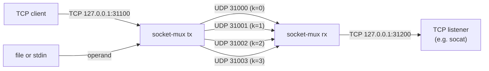

# socket-mux

socket-mux carries one stream over N UDP lanes. It is built to move data from an acquisition machine to a compute machine. TX reads one input (a TCP connection on localhost, standard input or a file) or generates a test pattern (`tx-pat`), and splinters it into N UDP lanes (N configurable, minimum 3). RX receives the lanes and reassembles the original stream. A header on every datagram lets RX put slices in order and measure loss. Nothing is retransmitted, so the channel is lossy. socket-mux is a Windows project that also runs on Linux and Mac. The MUX DMUX bot maintains both the TX and RX sides.

Command names, options, defaults and the pattern format are PROPOSAL.

## Features

| Feature  | What it does                                                                                 |
| -------- | -------------------------------------------------------------------------------------------- |
| `tx`     | Sends one TCP connection, standard input (`-`) or a file over N UDP lanes                    |
| `rx`     | Reorders the UDP lanes, skips lost bytes, logs each loss gap, and writes the stream to TCP   |
| `tx-pat` | Sends a continuous self-checking pattern instead of an input stream                          |

## Prerequisites

The Makefile takes every tool from `PATH` and the Rust toolchain that `rustc` selects; `make toolchain-check` names any missing dependency. Versions are the ones verified, written `N+` for that version or newer.

| Dependency                      | Version                            | Needed for                                                              |
| ------------------------------- | ---------------------------------- | ----------------------------------------------------------------------- |
| Rust (`rustc`, `cargo`)         | 1.98+                              | every build; `make dev`, `make check` and `make test` need nothing else |
| zig                             | 0.17+                              | release builds (`make`, `make all` and each platform target)            |
| cargo-zigbuild                  | 0.24+                              | release builds                                                          |
| Rust standard library targets   | 1.98+                              | one per release variant you build (see Platforms)                       |
| GNU make, bash                  | 4.4+, 5.2+                         | the Makefile                                                            |
| python3, socat, iproute2 (`ss`) | 3.13+, 1.8+, 6.15+                 | the verification helpers only (Linux)                                   |
| netcat, pv                      | traditional 1.10+ or OpenBSD, 1.9+ | the throughput exercise only                                            |

Build requirements:

| Resource   | Requirement                                      |
| ---------- | ------------------------------------------------ |
| RAM        | 2 GiB free                                       |
| Disk       | 4 GiB free (toolchain, all targets and builds)   |
| Network    | crates.io access for the first build             |
| Build host | Linux aarch64 (tested); other hosts are untested |

## Platforms

Build: `make <make target>`. Needs: `rustup target add <rust target>` (`make toolchain-help` lists them).

### Linux

Static (musl). Any distro.

| Variant | Make target          | Rust target                  |
| ------- | -------------------- | ---------------------------- |
| x86_64  | `linux-x86_64-musl`  | `x86_64-unknown-linux-musl`  |
| aarch64 | `linux-aarch64-musl` | `aarch64-unknown-linux-musl` |

### macOS

Sign before running: `make darwin-run-help`. Untested.

| Variant                             | Make target         | Rust target                                   |
| ----------------------------------- | ------------------- | --------------------------------------------- |
| Apple Silicon                       | `darwin-aarch64`    | `aarch64-apple-darwin`                        |
| Universal (Apple Silicon and Intel) | `darwin-universal2` | `aarch64-apple-darwin`, `x86_64-apple-darwin` |

### Windows

Windows 10+. Allow the UDP firewall prompt: `make win64-run-help`. Untested.

| Variant | Make target    | Rust target             |
| ------- | -------------- | ----------------------- |
| x86_64  | `win64-x86_64` | `x86_64-pc-windows-gnu` |

## Build

Run these in this folder (`projects/socket-mux`).

Note: in the c0dev container the default Rust toolchain home is read-only, so run `export RUSTUP_HOME=$HOME/.local/share/rustup-xc/` before using the Makefile.

```sh
make         # release build for this machine
make all     # release builds for every platform
make dev     # debug build: target/debug/socket-mux
make test    # unit tests
make help    # every target
```

Release binaries land in `target/<triple>/release/socket-mux` (`socket-mux.exe` for Windows). The examples below assume `socket-mux` is on your `PATH`.

## Dataflow

Default ports shown.



## Quickstart

Defaults (PROPOSAL):

| Setting       | Default                                                   |
| ------------- | --------------------------------------------------------- |
| Lanes (N)     | 4                                                         |
| UDP ports     | 31000-31003 (base 31000; lane k uses base+k on TX and RX) |
| TX sends to   | 127.0.0.1                                                 |
| TX TCP input  | listens on 127.0.0.1:31100 when no INPUT is given         |
| RX UDP bind   | 127.0.0.1                                                 |
| RX TCP output | connects to 127.0.0.1:31200                               |
| RX timeout    | 10 s                                                      |

Start three shells in the same directory, in this order:

```sh
socat -u TCP-LISTEN:31200,bind=127.0.0.1 OPEN:received.bin,creat,trunc   # shell 1: receives RX output
socket-mux rx                                                             # shell 2: listens on UDP 31000-31003
socket-mux tx original.bin                                                # shell 3: sends to UDP 31000-31003
```

When the file ends, TX sends end of stream, then TX, RX and socat exit 0. Check: `cmp original.bin received.bin` prints nothing.

## Usage

### Synopsis

```text
socket-mux [GLOBAL] tx [--listen ADDR:PORT] [--remote HOST] [INPUT]
socket-mux [GLOBAL] tx-pat [--remote HOST] [--seed U64]
socket-mux [GLOBAL] check-pat [--seed U64]
socket-mux [GLOBAL] rx [--bind IP] [--connect ADDR:PORT]
socket-mux --help | --version
```

### Commands

| Command     | Purpose                                         |
| ----------- | ----------------------------------------------- |
| `tx`        | Split the input stream across N UDP lanes       |
| `tx-pat`    | Split the test pattern across N UDP lanes       |
| `check-pat` | Check a pattern stream read from standard input |
| `rx`        | Reassemble the N UDP lanes into one TCP stream  |

### INPUT (tx)

| INPUT  | Source                                    |
| ------ | ----------------------------------------- |
| (none) | One TCP connection accepted on `--listen` |
| `-`    | Standard input                            |
| `FILE` | The file                                  |

### Command options

| Command        | Option                    | Meaning                                               |
| -------------- | ------------------------- | ----------------------------------------------------- |
| `tx`           | `-l, --listen ADDR:PORT`  | Loopback TCP listen address (default 127.0.0.1:31100) |
| `tx`, `tx-pat` | `-r, --remote HOST`       | Remote host name or IP (default 127.0.0.1)            |
| `tx-pat`       | `-s, --seed U64`          | Fixed pattern seed (default: random, logged at info)  |
| `check-pat`    | `-s, --seed U64`          | Also regenerate and compare every block body          |
| `rx`           | `-b, --bind IP`           | UDP bind IP (default 127.0.0.1)                       |
| `rx`           | `-c, --connect ADDR:PORT` | TCP output address (default 127.0.0.1:31200)          |

### Global options

Before or after the command. A value given twice takes the last one. Both sides need the same N and base port.

| Option                 | Meaning                                                           |
| ---------------------- | ----------------------------------------------------------------- |
| `-n, --streams N`      | Number of UDP lanes, minimum 3 (default 4)                        |
| `-p, --base-port PORT` | Lane k uses port PORT+k (default 31000)                           |
| `--udp-buffer BYTES`   | UDP send (TX) or receive (RX) buffer size                         |
| `--timeout SECONDS`    | RX timeout T for missing datagrams and end of stream (default 10) |
| `--log-level LEVEL`    | error, warn, info, debug or trace (default info)                  |
| `-v, --verbose`        | Raise the log level; repeatable                                   |
| `-q, --quiet`          | Lower the log level; repeatable                                   |
| `-h, --help`           | Print help                                                        |
| `-V, --version`        | Print the version                                                 |

### Exit status (PROPOSAL)

| Status | Meaning                             |
| ------ | ----------------------------------- |
| 0      | Success                             |
| 1      | Bind, connect, open or read failure |
| 2      | Usage error; no socket opened       |

Usage errors: `--listen` with INPUT, two INPUT operands, an option on the wrong command, N below 3.

### RX timing

RX delivers the stream strictly in sequence order. `--timeout` is an inter-packet delay timeout (default 10 seconds, set by Tomas). When a datagram is missing, RX holds what arrives after it until the timeout has passed since the datagram before the missing one arrived, then logs a `loss gap` and delivers on. When the timeout has passed since the last datagram RX received on any leg, RX declares every outstanding gap lost, delivers what it holds and closes its output. RX processes the end-of-stream datagram only in sequence, so a lost datagram ahead of it, or a lost end-of-stream datagram, is settled by the timeout. The option's spelling and the single deadline RX waits on are PROPOSAL ([SM-D21](docs/roadmap.md#sm-d21-proposal-inter-packet-delay-timeout-spelling-and-deadline)); whether a bound on held datagrams declares a gap lost sooner is an open decision. socket-mux never busy-waits: an idle TX or RX uses close to no CPU.

## Exercises

### 1. netcat/pv thruput

Measure how fast tx-pat sends, one lane at a time. tx-pat sends lane k to UDP port base+k; here the base port is 32000 and N is the default 4.

shell 1:

```bash
socket-mux -p 32000 tx-pat
```

shell 2:

```bash
nc -u -l -p 32000 | pv -8 -rab > /dev/null
```

What you see:

- pv shows the rate on lane 0 only. Datagrams go to the lanes in turn (round-robin, PROPOSAL), so each lane carries about 1/N of tx-pat's output; multiply by N for the total.
- nc writes each whole datagram, so the count includes the 22-byte header on each datagram (PROPOSAL layout), not just pattern bytes.
- pv flags: `-8` counts bits instead of bytes, `-r` shows the current rate, `-a` the average rate, `-b` the total. Tested with pv 1.9.
- netcat flavors differ: traditional and BusyBox netcat take `nc -u -l -p 32000`; OpenBSD netcat (also on macOS) takes `nc -u -l 32000`.
- nc must own the port. Do not run `rx` on the same ports at the same time.
- Stop with Ctrl-C in both shells; tx-pat runs until stopped.

All lanes: start one listener per port, 32000 to 32003, then start tx-pat in another shell. The sum of the four rates is tx-pat's total.

```bash
for k in 0 1 2 3; do nc -u -l -p $((32000 + k)) | pv -8 -rab -N lane$k > /dev/null & done   # shell 2
```

End to end: measure what RX reassembles instead. A TCP listener on RX's delivery port feeds pv; `--udp-buffer` keeps loopback from overflowing RX's receive queues. Compare this rate with the lane rates above.

```bash
socat -u TCP-LISTEN:31200,bind=127.0.0.1 STDOUT | pv -8 -rab > /dev/null   # shell 1
socket-mux -p 32000 --udp-buffer 8388608 rx                                 # shell 2
socket-mux -p 32000 --udp-buffer 8388608 tx-pat                             # shell 3
```

RX logs a `loss gap` line for every gap it skips. No such line means the reassembled rate is the full stream.

### 2. tx-pat into rx

Send the pattern through RX and save what arrives. The `--seed` option is PROPOSAL. Whether tx-pat stops or paces itself is open, so you stop it.

1. Start the sink and RX:

   ```sh
   socat -u TCP-LISTEN:31200,bind=127.0.0.1 OPEN:pattern.bin,creat,trunc   # shell 1
   socket-mux --udp-buffer 8388608 rx                                       # shell 2
   ```

1. Run the pattern with a fixed seed for about a second, then press Ctrl-C:

   ```sh
   socket-mux --udp-buffer 8388608 tx-pat --seed 42                         # shell 3
   ```

1. Within 10 seconds RX's timeout ends the stream, RX closes its output and socat exits. RX logs a `loss gap` line for every gap it skipped.

`pattern.bin` is a run of 4096-byte blocks. Each block carries its index and an Adler-32 checksum, so a checker can find its place again after any loss gap. socket-mux has no checker command yet: a `check-pat` subcommand is on the roadmap ([SM-D22](docs/roadmap.md#sm-d22-proposal-check-pat-checker-subcommand)), and the verification loop checks the pattern with its own independent checker.

Without `--seed`, tx-pat picks a random seed and logs `tx-pat seed=<n>` at start. Runs with the same seed send the same bytes.

## Testing

```sh
make test                                       # unit and integration tests
V=.cursor/skills/verify-socket-mux/scripts/vsm
$V doctor                                       # check harness tools
$V loop --case lossless                         # TX to RX on loopback, byte compare
```

| Suite       | Covers                                                                                                      |
| ----------- | ----------------------------------------------------------------------------------------------------------- |
| `make test` | Unit and integration tests                                                                                  |
| `vsm loop`  | `tx` to `rx` on loopback: lossless, injected loss (datagram, burst, dead lane), delay, pause, end of stream |
| `vsm pat`   | `tx-pat` to `rx`, checked by an independent pattern checker                                                 |
| `vsm cpu`   | Idle and paced CPU                                                                                          |

Harness needs: Linux, `python3`, `socat`, `ss`. Full matrix: [test-matrix.md](.cursor/skills/verify-socket-mux/test-matrix.md).

## Documentation

- [Authority index](docs/index.md): start here; routes to the goals, roadmap, specification, design and known issues.
